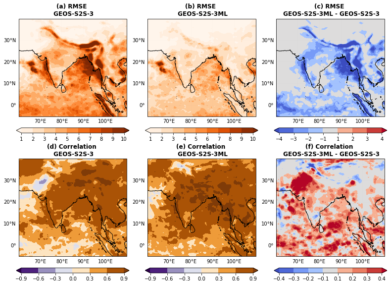
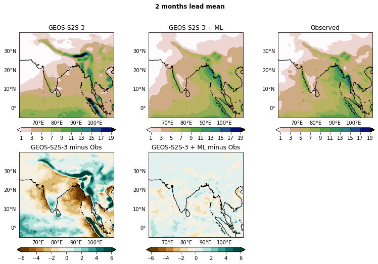
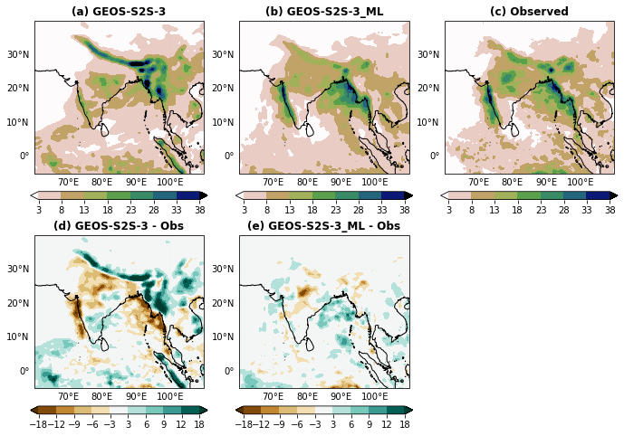
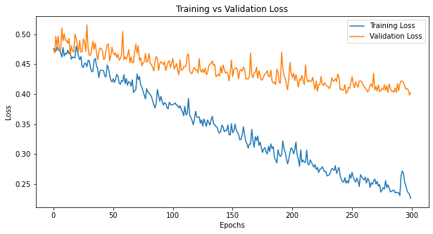
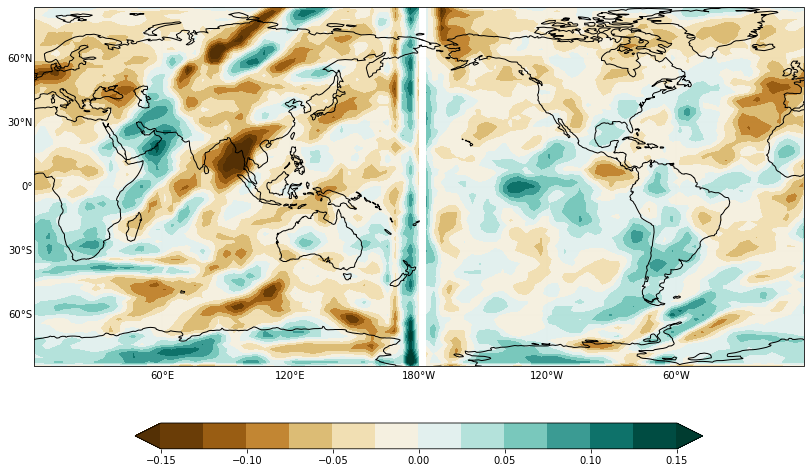
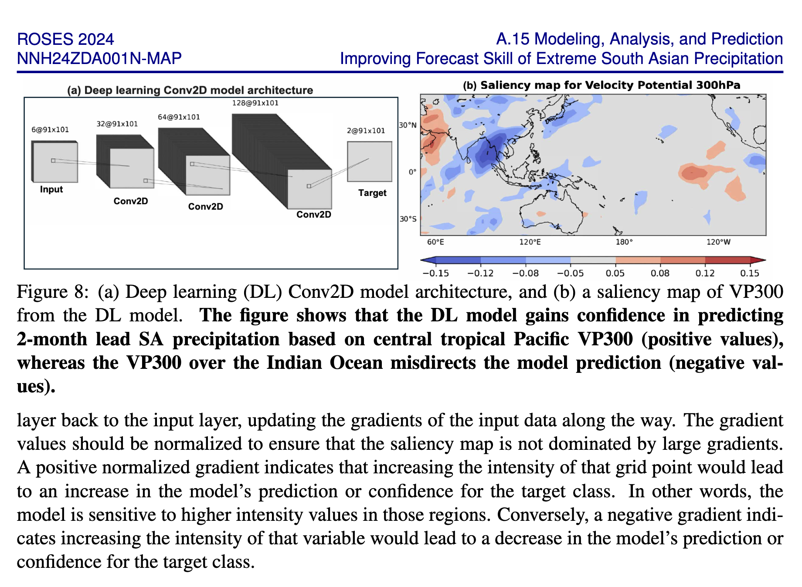
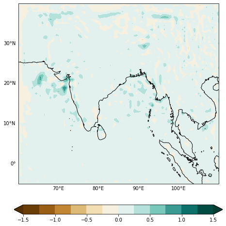
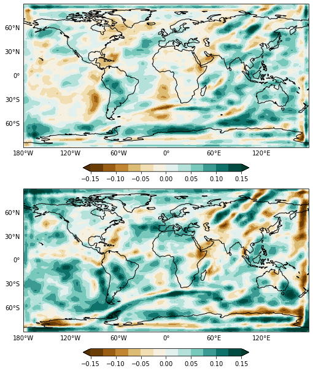

# South Asian Monsoon Precipitation Bias Correction

Machine-learning experiments for correcting **GEOS-S2S-3 precipitation forecasts
over South Asia** at one- and two-month leads. The notebooks map gridded forecast
inputs to observed precipitation with convolutional neural networks (CNNs), compare
raw and corrected forecasts using RMSE, temporal correlation, and bias maps, and
explore input sensitivity with gradient saliency.

This repository organizes the research notebooks and saved outputs supplied in
`precip_SA.tar`. Training data and trained weights were **not included**. The plots
below are original saved notebook outputs, exported without rerunning training.
The archive does not identify the observation product, complete data period, or
precipitation units, so these are exploratory diagnostics rather than a fully
reproducible benchmark.

## Where this was run and where the data are

The original experiments were run on **PRISM at NASA's NCCS (NASA Center for
Climate Simulation)**. The archived notebooks used the working directory
`/home/afahad/nb/precip_SA/`. This is the original recorded project/data location
on that environment; its current availability has not been checked from this
checkout.

| Input or checkpoint | Original location on PRISM | Purpose |
| --- | --- | --- |
| `ml_data_pr.npz` | `/home/afahad/nb/precip_SA/ml_data_pr.npz` | Prepared precipitation predictors `X`, observed targets `Y`, coordinates `lon`/`lat`, and sample dates `date`. |
| `ml_data1.npz` | `/home/afahad/nb/precip_SA/ml_data1.npz` | Auxiliary `X1` predictors labeled GEOS-S2S-3 VP in the notebook, with `lon1`/`lat1`. |
| `ml_data2.npz` | `/home/afahad/nb/precip_SA/ml_data2.npz` | Auxiliary predictors stored under `X1`, labeled M2 VP in the notebook. |
| `random_numbers.npz` | `random_numbers.npz` relative to the original working directory | Saved sample permutation; included here as `data/random_numbers.npz`. |
| Model weights | `/home/afahad/nb/precip_SA/best_model_weights.h5`, `best_model_weights2.h5`, and `best_model_weights_unet.h5` | Checkpoint paths used by the three model notebooks. |

The large training arrays and checkpoints remain external to this repository;
they were not present in the supplied archive. Use the original PRISM location
when the files are available there, or obtain copies from the project owner.
The repository contains the prepared-array loading workflow, not the upstream
raw-data acquisition or preprocessing pipeline. Full array keys and assumptions
are listed in [data/README.md](data/README.md).

In this organized checkout, the default input and checkpoint folders are `data/`
and `models/`. To use the original directory from a PRISM session, set the paths
before launching Jupyter from the repository root:

```bash
export PRECIP_DATA_DIR=/home/afahad/nb/precip_SA
export PRECIP_WEIGHTS_DIR=/home/afahad/nb/precip_SA
python -m jupyterlab
```

The core notebooks use Python, TensorFlow/Keras, NumPy, xarray, Dask, and
Matplotlib/Cartopy. Archived kernel metadata reports Python 3.12.8. Their setup
detects available GPUs and enables TensorFlow GPU memory growth; the exact GPU
hardware, CUDA version, package versions, and scheduler/job configuration were
not recorded in the archive.

## Project contents

```text
.
├── notebooks/
│   ├── GEOS_ML_precip.ipynb          # Three-channel precipitation CNN baseline
│   ├── GEOS_ML_precip2.ipynb         # Seven-channel CNN with auxiliary VP inputs
│   ├── GEOS_ML_precip3_unet.ipynb    # Deep-supervision CNN; U-Net code is commented
│   └── exploratory/
│       ├── Untitled.ipynb           # Plotly/Leafmap wind-mapping experiments
│       └── Untitled1.ipynb          # NetCDF-to-GeoJSON and interpolation sketch
├── scripts/export_readme_figures.py # Exports saved notebook PNGs; no model execution
├── figures/                        # README plots, source manifest, original GEOSML.png
├── data/                           # Saved permutation and input-data documentation
├── models/                         # Checkpoint documentation; weights supplied separately
├── artifacts/mymap.html            # Archived interactive wind-map export
├── docs/NOTEBOOK_GUIDE.md           # Workflow, model details, and known limitations
├── requirements.txt                # Inferred core dependencies; not a tested lockfile
└── requirements-mapping.txt         # Optional mapping-notebook dependencies
```

## What the notebooks and script do

| File | Purpose and behavior |
| --- | --- |
| [GEOS_ML_precip.ipynb](notebooks/GEOS_ML_precip.ipynb) | Baseline CNN: three input channels, Conv2D filters 32/64/128, two linear precipitation outputs, Adam/MSE. Includes training, prediction, RMSE/correlation, mean/case maps, and saliency experiments. |
| [GEOS_ML_precip2.ipynb](notebooks/GEOS_ML_precip2.ipynb) | Adds auxiliary inputs labeled GEOS-S2S-3 VP and M2 VP in the code, standardizes input groups/targets, and uses a seven-channel CNN with filters 32/64/128/256. Training is commented out; prediction requires separately supplied weights or enabling training. |
| [GEOS_ML_precip3_unet.ipynb](notebooks/GEOS_ML_precip3_unet.ipynb) | Explores deeper models. The active final model is a CNN with intermediate/final output heads and weighted MSE losses; the U-Net implementation is commented out. Includes saved training curves and forecast/saliency plots. |
| [Untitled.ipynb](notebooks/exploratory/Untitled.ipynb) | Separate visualization experiments: US county choropleth, sample global-wind NetCDF, Leafmap raster/velocity layers, and HTML export. |
| [Untitled1.ipynb](notebooks/exploratory/Untitled1.ipynb) | Draft conversion of a wind grid to GeoJSON points plus xarray interpolation; needs cell-order fixes before clean execution. |
| [export_readme_figures.py](scripts/export_readme_figures.py) | Extracts seven selected PNG outputs, including three saliency figures, from the notebooks and writes [manifest.json](figures/manifest.json) with source cell/output indices and SHA-256 hashes. Uses only the Python standard library. |

See the [notebook guide](docs/NOTEBOOK_GUIDE.md) for training settings, evaluation
logic, and known issues in the archived research code.

## How the models were trained

The notebooks implement supervised learning from prepared gridded predictors to
two observed precipitation target channels, labeled one- and two-month lead in
the plots. Inputs and targets use channel-last arrays with a 91 × 101 spatial
grid. The baseline uses three precipitation input channels. The augmented CNN
and deep-supervision experiment concatenate precipitation and the two auxiliary
VP input groups into seven channels.

The training workflow encoded in the notebooks is:

1. **Load and prepare arrays.** The baseline passes precipitation inputs and
   targets through without active standardization. The augmented notebooks
   replace auxiliary-input NaNs with each array's global mean, standardize each
   input group and the targets using its global mean and standard deviation,
   and concatenate the standardized input groups.
2. **Apply the saved sample ordering.** Load `random_numbers.npz` and apply the
   same permutation to predictors, targets, and dates. Samples `0:500` form the
   training/validation pool; samples `500:` are reserved for testing.
3. **Fit the CNN.** Models use 3 × 3 convolutions with ReLU activation and batch
   normalization, followed by linear two-channel output layers. Optimization
   uses Adam and mean squared error (MSE). The deep-supervision CNN has two
   prediction heads with loss weights 0.5 for the intermediate output and 1.0
   for the final output.
4. **Select weights using validation loss.** The active training cells use
   `ModelCheckpoint` with `monitor='val_loss'`, `mode='min'`,
   `save_best_only=True`, and `save_weights_only=True`. The validation subset
   comes from the 500-sample pool through Keras `validation_split`; it is separate
   from the test samples. The supplied code has no early-stopping callback.
5. **Reload and evaluate.** Load the selected checkpoint, predict on the test
   samples, and undo target standardization where applied. The deep-supervision
   notebook selects the final prediction head. Diagnostics compare corrected
   and raw GEOS forecasts against observations using RMSE, temporal correlation,
   mean bias, and individual-case maps.

| Notebook/model | Epochs requested in code | Batch size | Validation fraction of the 500-sample pool | Checkpoint | State in supplied notebook |
| --- | --- | --- | --- | --- | --- |
| `GEOS_ML_precip.ipynb` — baseline | 500 | 16 | 0.15 (75 validation; 425 fitting samples) | `best_model_weights.h5` | Training cell is active. |
| `GEOS_ML_precip2.ipynb` — augmented CNN | 100 | 100 | 0.10 (50 validation; 450 fitting samples) | `best_model_weights2.h5` | Training and checkpoint callback are commented out; prediction loads existing weights. These are the commented training settings, not a verified completed run. |
| `GEOS_ML_precip3_unet.ipynb` — deep-supervision CNN | 300 | 32 | 0.10 (50 validation; 450 fitting samples) | `best_model_weights_unet.h5` | Training cell is active and saved loss curves are included. The active model is a CNN with two output heads. |

Each notebook attempts to load existing weights before training, so a run may
resume from a supplied checkpoint rather than start from random initialization.
Epoch counts above describe the requested fit settings; the archive does not
provide a complete run manifest establishing the initialization and execution
history for every saved result. The augmented preprocessing computes scaling
statistics before splitting; review the [scientific and reproducibility notes](#scientific-and-reproducibility-notes)
before retraining or comparing models. No new training was performed during
repository organization.

## Which version to use for handoff

**Start with [GEOS_ML_precip2.ipynb](notebooks/GEOS_ML_precip2.ipynb)** for a
research handoff. It is the recommended starting point because it combines the
seven-channel input workflow with saved RMSE, correlation, bias, and case-map
diagnostics. It is a notebook, not a standalone prediction script or a packaged
deployment model. Its weights and data must be supplied separately.

| Version | Role | Handoff recommendation |
| --- | --- | --- |
| `GEOS_ML_precip.ipynb` | Three-channel baseline | Use for understanding the simpler model and as a baseline comparison. |
| **`GEOS_ML_precip2.ipynb`** | Seven-channel augmented CNN | **Primary handoff notebook** for reviewing the existing forecast-correction workflow and saved skill diagnostics. |
| `GEOS_ML_precip3_unet.ipynb` | Most advanced experiment in the supplied numbered sequence: a CNN with intermediate/final prediction heads | Use for continuing model development. The active model is not a U-Net; U-Net code is commented out. |

**Latest experimental version:** notebook 3 in the numbered sequence. This is an
ordering inferred from the filenames and model progression, not a release date
or a documented production designation. **Best-performing version:** not
established by this archive. There is no controlled side-by-side evaluation of
all three models, complete evaluation metadata, or supplied checkpoints that
would justify naming an accuracy winner. Notebook 2 is recommended for handoff
readiness, not proven superior predictive performance.

For the person taking over:

1. Read this README, [data requirements](data/README.md),
   [checkpoint requirements](models/README.md), and the
   [notebook guide](docs/NOTEBOOK_GUIDE.md).
2. Open `notebooks/GEOS_ML_precip2.ipynb` in Jupyter and select the project kernel.
   Supply `ml_data_pr.npz`, `ml_data1.npz`, `ml_data2.npz`, and the compatible
   `best_model_weights2.h5` checkpoint. Keep the included sample permutation.
3. Run the path/import, loading, normalization, permutation, model-definition,
   and split cells in order, then load weights and run prediction/evaluation.
   If retraining, enable the commented training cell and resolve the environment
   and checkpoint compatibility notes first.
4. Validate normalization, channel alignment, and the temporal evaluation split
   before treating the results as a reproducible benchmark. Carry notebook 3
   forward as a separate development experiment and compare it on the same
   held-out data before selecting a best model.

For a **documentation-only handoff**, run
`python3 scripts/export_readme_figures.py`. This refreshes the seven notebook-derived README plots
from saved notebook outputs; it does not train a model or run new forecasts.

## Saved plots

Seven plots in the forecast and XAI sections come directly from embedded notebook outputs;
the supplied proposal reference is identified separately below. Source cell
indices are zero-based and recorded in the [figure manifest](figures/manifest.json).
The separate [GEOSML.png](figures/GEOSML.png) is preserved as supplied; its exact
generating cell was not established.

### Forecast skill at two-month lead



From `GEOS_ML_precip2.ipynb`, cell 43. Top row: raw forecast RMSE, corrected RMSE,
and corrected-minus-raw RMSE. Bottom row: raw correlation, corrected correlation,
and their difference. Negative RMSE differences and positive correlation
differences indicate improvement in this saved comparison. These are gridpoint
diagnostics over the notebook's test samples, not a separately validated score.

### Mean precipitation and bias at two-month lead



From `GEOS_ML_precip2.ipynb`, cell 46. The upper panels compare test-set mean raw
GEOS precipitation, corrected precipitation, and observations. Lower panels show
forecast-minus-observation mean bias; values closer to zero indicate less bias.

### Example forecast and observed precipitation



From `GEOS_ML_precip2.ipynb`, cell 40. A saved individual-case comparison at the
second lead: raw forecast, corrected forecast, observations, and their biases.
The saved figure has no date label; no date is inferred here.

### Training and validation loss



From `GEOS_ML_precip3_unet.ipynb`, cell 27. This archived curve shows the training
and validation loss histories. Their widening gap warrants review of
generalization; the curve alone does not establish predictive skill or a U-Net
result.

## Explainable AI (XAI): gradient saliency maps

The saliency experiments ask **which input locations and channels the model's
predicted precipitation is locally sensitive to**. They differentiate a scalar
summary of the model output with respect to the input tensor. This is a
post-training diagnostic: it does not update model weights. TensorFlow's
[`GradientTape` automatic differentiation](https://www.tensorflow.org/guide/autodiff)
records the prediction computation and calculates these input gradients.

### Which code produces the VP300-style saliency map?

The relevant code is in **[GEOS_ML_precip2.ipynb](notebooks/GEOS_ML_precip2.ipynb)**.
Search for `with tf.GradientTape() as tape:` to find the gradient calculation and
`sal=np.nanmean(saliency_map[:,:,:,6],0)` to find the channel selected for the
Pacific-centered map. The same workflow is also present in
[GEOS_ML_precip3_unet.ipynb](notebooks/GEOS_ML_precip3_unet.ipynb).

The following indices count **all notebook cells from zero**, including empty
cells; they are not Jupyter `In[...]` execution numbers.

| Operation | `GEOS_ML_precip2.ipynb` | `GEOS_ML_precip3_unet.ipynb` |
| --- | --- | --- |
| Watch inputs, predict, differentiate the mean prediction, and normalize gradients | Cell 53 | Cell 47 |
| Convert gradients to the NumPy array `saliency_map` | Cell 54 | Cell 48 |
| Compute sample-mean saliency of input channel 6 as `sal` | Cell 61 | Cell 56 |
| Build an xarray dataset with `lon1`/`lat1` coordinates | Cell 63 | Cell 58 |
| Define/use `wrap360` to wrap longitude coordinates | Definition in cell 57; call in cell 65 | Definition in cell 52; call in cell 60 |
| Define the Pacific-centered Cartopy plotting helper | Cell 66 | Cell 61 |
| Draw the saved Pacific-centered map | Cell 67 | Cell 62 |

The gradient calculation in notebook 2, cells 53–54, is:

```python
X_sample = tf.convert_to_tensor(original_X.astype(np.float32), dtype=tf.float32)
with tf.GradientTape() as tape:
    tape.watch(X_sample)
    predictions = model(X_sample)
    loss = tf.reduce_mean(predictions)

grads = tape.gradient(loss, X_sample)
normalized_grads = grads / (tf.sqrt(tf.reduce_mean(tf.square(grads))) + 1e-5)
saliency_map = normalized_grads.numpy()
```

Cell 61 selects and averages the channel for the later regional view:

```python
sal = np.nanmean(saliency_map[:, :, :, 6], axis=0)
```

Cells 63–67 attach coordinates, wrap longitudes, define a helper using
`ccrs.PlateCarree(central_longitude=180)` and the requested extent
`[60, 250, -40, 40]`, then call:

```python
fig = plt.figure(figsize=(11, 8.5))
ax = plot(sal, sal1.lon, lat1, clf=clf, cmap=cmap, sub=[1, 1, 1], fig=fig)
plt.tight_layout()
```

This last block depends on the preceding data, model, gradient, coordinate, and
plot-helper cells; it is not a standalone script. The actual saved output of
notebook 2, cell 67, is:



The archived output is a full-world view with a brown/teal palette, despite the
regional extent in the current helper source. This source/output mismatch means
the saved PNG cannot establish the exact plotting state used to generate it.
Longitude/data alignment also needs review: `wrap360` sorts the dataset, while
the final call passes the original `sal` values with the wrapped longitude array.

### Supplied VP300 proposal figure and its relationship to the code



This is the supplied proposal screenshot, preserved unchanged as a **reference
figure**, rather than an exported notebook result. Its panel (b) identifies the
field as **velocity potential at 300 hPa (VP300)**. The gradient-and-map workflow
above is the relevant implementation found in the archive, but an exact match to
this red/blue regional panel was not found among the saved main-notebook or
checkpoint saliency outputs inspected.

The reference architecture shows six input channels and convolution layers
32/64/128. The current augmented notebook defines seven input channels and layers
32/64/128/256, so the reference may represent another experiment revision.
The archived inputs are labeled VP and M2 VP in code, but their channel metadata
does not establish that channel 6 is the exact VP300 field used in the reference.
The implemented gradient target also averages both output leads rather than
explicitly selecting the second lead. Confirm the original checkpoint, feature
definitions, target selection, and plotting revision before claiming an exact
reproduction of the proposal panel.

Positive and negative values indicate the direction of local prediction
sensitivity. The regression code computes neither a confidence probability nor
whether a feature improves accuracy; those interpretations require additional
evaluation beyond the gradient sign.

### How the notebook calculation works

1. Convert the input samples to a floating-point TensorFlow tensor and explicitly
   watch that tensor with `tape.watch(X_sample)`.
2. Run `predictions = model(X_sample)` inside `tf.GradientTape()` and reduce the
   predictions to a scalar with `score = tf.reduce_mean(predictions)`. In the
   single-output CNN notebooks, this averages over samples, output grid cells,
   and both lead channels. It is not a gradient of forecast error against observations.
3. Compute `grads = tape.gradient(score, X_sample)`. Each value describes the
   local response of the mean prediction to a small increase in one input value,
   holding the other inputs fixed.
4. Rescale the gradients with
   `normalized_grads = grads / (sqrt(mean(grads**2)) + 1e-5)`. The denominator is
   one root-mean-square value over the gradient tensor, plus a small stabilizer.
   This preserves signs and rescales magnitudes; the values are not percentages
   or precipitation amounts.
5. Plot a selected channel on its input coordinates. Mean maps use
   `np.nanmean(saliency_map[..., channel], axis=0)` across samples; individual-case
   maps select one sample instead. Averaging signed gradients can cancel opposing
   responses, so a weak mean map can hide stronger case-specific sensitivity.

This implementation uses ordinary input gradients. It does not implement SHAP,
Grad-CAM, or Integrated Gradients; the latter integrates gradients along an input
path, as described in [TensorFlow's Integrated Gradients tutorial](https://www.tensorflow.org/tutorials/interpretability/integrated_gradients).

### Saved precipitation-input saliency



From `GEOS_ML_precip.ipynb`, cell 38, using the gradient calculation in cells
36–37. This is the mean signed normalized gradient for **input channel 2**
(zero-based), plotted over South Asia. Teal/green denotes positive sensitivity:
a small increase in that input increases the mean predicted output locally in
input space. Brown denotes negative sensitivity; pale colors are near zero.
The location shown is the input location, not necessarily the location of an
affected output grid cell. Because the score averages both output leads, this
map is not specific to one forecast lead.

### Saved auxiliary-input saliency



From `GEOS_ML_precip2.ipynb`, cell 60, using the calculation in cells 53–54.
The upper and lower panels show sample-mean signed normalized gradients for
**input channels 3 and 4**, respectively, plotted on the auxiliary `lon1`/`lat1`
coordinates. These are the first two auxiliary channels after the three
precipitation channels; confirm their physical definitions with the NPZ data
before assigning specific variable/lead labels. The broad patterns are archived
model-sensitivity diagnostics, not evidence of causal atmospheric connections.

### How to use and interpret XAI during handoff

Use the maps to inspect whether sensitivity falls in plausible regions, compare
channels and individual cases, and identify unexpected model behavior for further
testing. Large absolute gradients indicate greater **local sensitivity to the
chosen scalar output**, not a guaranteed contribution to forecast skill. Near-zero
gradients do not prove a feature is irrelevant.

The archived augmented-model saliency calculation feeds `original_X` into a
model trained on standardized inputs. It also reconstructs all seven input
channels using precipitation-group scaling. These input-space inconsistencies
must be corrected before treating the auxiliary maps as explanations of normal
inference. The displayed PNGs are preserved outputs and have not been recomputed.

For a new XAI run, load the intended checkpoint, feed the same standardized
`X_norm_test` used for inference in the augmented models, and call
`model(inputs, training=False)`. In notebook 3, explicitly select the final output
head before reducing it to a scalar. To explain a particular lead, region, or
case, select that target before taking its mean and differentiating. Record the
checkpoint, input preprocessing, target selection, and channel definitions with
the resulting plot. The baseline notebook uses its unstandardized inputs because
that is how its model is trained.

To refresh the three archived XAI plots together with the forecast figures, run
`python3 scripts/export_readme_figures.py`. Recomputing gradients requires the
external data and compatible trained weights; exporting the saved PNGs does not.
The separately supplied proposal reference is a static image and is not recreated
by the exporter.

## Setup and use

View the saved outputs on GitHub without installing anything. To work locally:

```bash
git clone https://github.com/afahadabdullah/monsoon_bias_MAP24.git
cd monsoon_bias_MAP24
python3 -m venv .venv
source .venv/bin/activate
python -m pip install -r requirements.txt
python -m ipykernel install --user --name monsoon-bias --display-name "Monsoon bias"
python -m jupyterlab
```

Select the `Monsoon bias` kernel and open a notebook under `notebooks/`. The
dependency lists were inferred from imports; no original environment lock was
provided and this installation has not been validated for training. Archived
core notebook metadata reports Python 3.12.8, but does not record package versions.
Match TensorFlow/Keras to any supplied checkpoints; see [checkpoint notes](models/README.md)
for the legacy `.h5` filenames and modern Keras suffix requirements.

Before executing model cells:

1. Supply the datasets listed in [data/README.md](data/README.md). Required keys
   include `X`, `Y`, `lon`, `lat`, `date`, and auxiliary `X1` arrays. The model code
   assumes a 91 × 101 grid, three or seven input channels, and two target channels.
2. Put weights in `models/`, or enable/configure training before prediction.
   Notebook 2's unconditional weight load requires an existing compatible checkpoint.
3. Start Jupyter inside this checkout. The first code cell resolves paths from the
   repository root. Optional `PRECIP_DATA_DIR` and `PRECIP_WEIGHTS_DIR` environment
   variables, set before starting Jupyter, point to external data/weight folders.
4. Review the [known notebook issues](docs/NOTEBOOK_GUIDE.md) before using Run All.
   Saved outputs remain available even when dependencies or external inputs are missing.

Generated training figures go to ignored `results/`; input datasets and weights
are also ignored. The saved `data/random_numbers.npz` permutation stays tracked.
Mapping notebooks use a separate optional dependency list:

```bash
python -m pip install -r requirements-mapping.txt
```

To refresh only the README figures from saved outputs, without data, TensorFlow,
or notebook execution:

```bash
python3 scripts/export_readme_figures.py
```

## Scientific and reproducibility notes

The experiments permute samples, use the first 500 for training, and use the
remainder for testing. In the augmented notebooks, scaling statistics are computed
before splitting, allowing test information into preprocessing. This random split
does not demonstrate skill on independent years. Refit scaling on training data
and evaluate with a suitable temporal split before drawing generalization claims.

Some late plotting and saliency cells depend on missing variables/files, inconsistent
channel choices, or assumptions about model outputs. The mapping experiments also
contain saved errors. These issues are documented in the [notebook guide](docs/NOTEBOOK_GUIDE.md);
organization and path changes do not resolve the underlying research questions.
No model training or numerical reproduction was performed during this cleanup.
